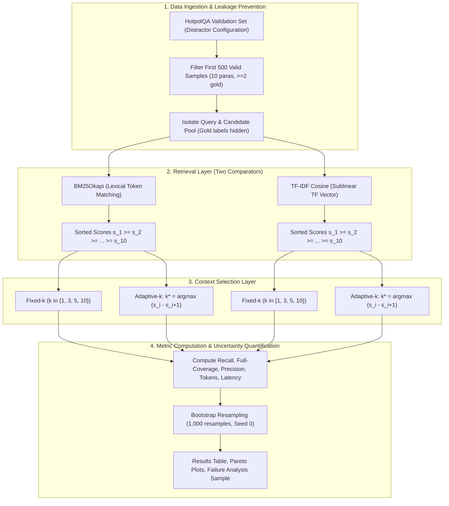

# Frozen Experimental Protocol (Gate G3 Prerequisite)

**Project Title**: Fixed-k versus Adaptive-k Context Selection for Multi-Hop QA: An Evidence-Coverage and Token-Efficiency Study  
**Protocol Version**: 1.0-FROZEN  
**Date Frozen**: 2026-11-05  
**Random Seeds**: Experiment Seed = `42`, Bootstrap Seed = `0`  
**Git Tag**: `protocol-frozen`  

---

## 1. Experimental Pipeline Architecture

---

## 2. Experimental Factors & Conditions

| Factor | Levels / Specifications | Rationale & Control |
| :--- | :--- | :--- |
| **Dataset & Split** | HotpotQA validation set, distractor configuration, first 500 valid questions. | Standard multi-hop benchmark requiring information chaining across separate paragraphs. |
| **Candidate Pool** | Exactly 10 candidate paragraphs per question (2 gold, 8 distractors). | Held constant across all conditions. |
| **Retrievers** | 1. **BM25** (`rank_bm25.BM25Okapi`, $k_1=1.5, b=0.75$) 2. **TF-IDF** (`sklearn.feature_extraction.text.TfidfVectorizer`, sublinear TF, cosine similarity) | Controlled comparison between classical frequency-based probabilistic vs vector-space retrieval. |
| **Selection Methods** | 1. **Fixed-$k$**: $k \in \{1, 3, 5, 10\}$ 2. **Adaptive-$k$**: $k^* = \arg\max_{i \in \{1, \dots, 9\}} (s_i - s_{i+1})$, fallback $k=3$ if tie. | Isolates the single-pass score-drop cutoff proposed by Taguchi et al. (2025) against static token budgets. |
| **Baselines & Controls** | 1. Random Selection Control ($k=1, 3, 5$, averaged over 5 seeds). 2. Upper bound sanity check ($k=10$ must produce 100% recall). | Verifies lower and upper bounding conditions for sanity testing. |

---

## 3. Evaluation Metrics & Directionality

1. **Evidence Recall** ($\uparrow$ higher is better):
   $$\text{Recall} = \frac{|\mathcal{P}_{\text{selected}} \cap \mathcal{P}_{\text{gold}}|}{|\mathcal{P}_{\text{gold}}|}$$
2. **Full-Coverage Rate** ($\uparrow$ higher is better):
   $$\text{Full-Coverage} = \mathbb{I}(|\mathcal{P}_{\text{selected}} \cap \mathcal{P}_{\text{gold}}| = |\mathcal{P}_{\text{gold}}|)$$
3. **Selection Precision** ($\uparrow$ higher is better):
   $$\text{Precision} = \frac{|\mathcal{P}_{\text{selected}} \cap \mathcal{P}_{\text{gold}}|}{|\mathcal{P}_{\text{selected}}|}$$
4. **Selected Tokens / Words** ($\downarrow$ lower is better):
   Total whitespace-delimited words and token approximations of the selected context text.
5. **Selection Latency** ($\downarrow$ lower is better):
   Wall-clock latency per question in milliseconds (ms).
6. **Primary Metric — Coverage per 1,000 Tokens** ($\uparrow$ higher is better):
   $$\text{Coverage per 1k Tokens} = \frac{\text{Evidence Recall}}{\text{Selected Tokens}} \times 1000$$

---

## 4. Pre-Frozen Decision Rules

- **Decision Rule 1 (RQ1 - Token Efficiency Frontier)**:
  *Adaptive-$k$ is supported as superior in token efficiency if and only if its 95% bootstrap confidence interval for Coverage per 1,000 tokens strictly exceeds that of all fixed-$k$ configurations ($k \in \{1, 3, 5, 10\}$) for that retriever.* If intervals overlap or fixed-$k$ is superior, the hypothesis is contradicted or unresolved.
- **Decision Rule 2 (RQ2 - Multi-hop Full Coverage)**:
  *Adaptive-$k$ is supported as matching fixed-$k=5$ full-coverage capability if its mean full-coverage rate is within $\pm 5\%$ of fixed-$k=5$ while its upper 95% bootstrap CI for selected tokens is strictly below the lower 95% bootstrap CI of fixed-$k=5$.*
- **Decision Rule 3 (RQ3 - Failure Distribution)**:
  *A seeded random sample of 40 missed-evidence questions ($seed=42$) will be extracted into `results/tables/failure_sample.csv` and classified into four pre-frozen categories.*

---

## 5. Pre-Frozen Failure Categories
1. **Lexical Mismatch / Paraphrasing**: Question uses vocabulary absent from the gold paragraph text.
2. **Bridge Entity Missing from Query**: The second-hop gold paragraph connects only via an entity mentioned in the first-hop paragraph, not in the original query.
3. **High-Overlap Distractor**: A distractor paragraph shares superficial keyword overlap with the question, scoring higher than gold evidence.
4. **Ranking Tie / Flat Slope**: Similarity scores across candidate paragraphs decay uniformly without a clear elbow point, causing sub-optimal cutoff.

---

## 6. Threats to Validity
- **Candidate Pool Truncation**: HotpotQA distractor setting fixes the candidate pool to 10 paragraphs. Findings may not generalize to unbounded web-scale corpora.
- **Sparse Heuristics on Uncalibrated Scores**: Raw BM25 scores are unbounded; discrete differences can vary with document length.
- **Reader Independence**: The pilot measures evidence selection accuracy. It does not measure downstream reader hallucinations or generation accuracy directly.
